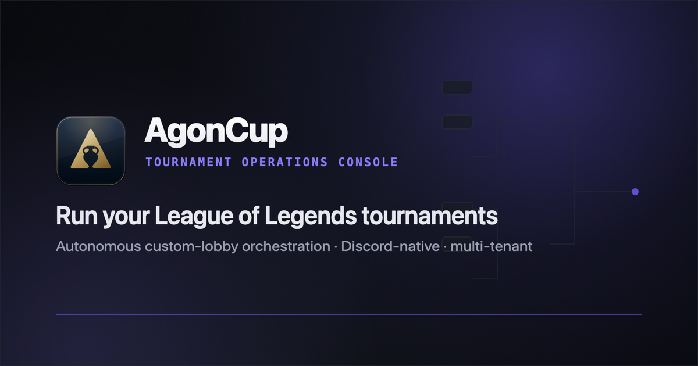
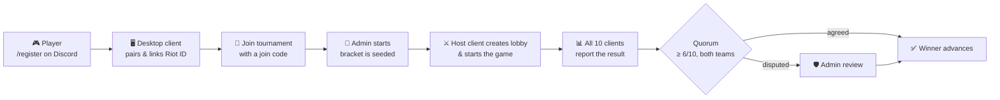
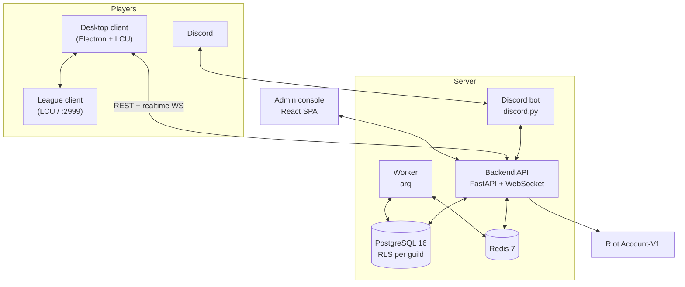

<div align="center">



# AgonCup

**Run *League of Legends* tournaments end-to-end, from Discord sign-up to an automatically played, automatically verified final.**


Public beta: live at [lol.gameras.gr](https://lol.gameras.gr) and used by 5 Greek Discord communities.

[Features](#features) · [How it works](#how-it-works) · [Architecture](#architecture) · [Quickstart](#quickstart) · [Docs](#documentation)

</div>

---

## Overview

AgonCup is a multi-tenant tournament platform for League of Legends. Any Discord
server can invite the AgonCup bot and run its own tournaments: up to 16 teams per
tournament, with many tournaments running in parallel. Results can optionally be
featured in the central AgonCup community, with consent and approval.

Instead of relying on Riot's Tournament API, AgonCup runs matches autonomously.
A lightweight desktop client creates the custom lobby through the player's own
League client, invites everyone, starts the game and collects the result. The backend
then cross-checks the reports from all ten players before a winner is recorded.

## Features

| | |
|---|---|
| 🏆 **Tournaments** | Single- and double-elimination brackets, 1v1 ARAM and 5v5 Summoner's Rift, registration, check-in, seeding and automatic byes |
| 🤖 **Discord-native** | `/register`, `/link`, `/tournament-create`, `/tournament-start`, plus DM and channel notifications. Multi-guild and auto-sharded |
| 🖥️ **Desktop client** | Electron app for Windows and macOS. Links your Riot account, hosts the lobby automatically, shows a live scoreboard and has a "Find a team" board |
| 🧠 **Autonomous matches** | Lobby creation, PUUID invites, auto-accept and game start via the local LCU API, with epoch-fenced host failover |
| ✅ **Verified results** | A result is accepted only when at least 6 of 10 identity-bound reports agree and both teams are represented, after an anomaly screen |
| 🛡️ **Admin console** | React SPA for tournaments, teams, accounts, servers, match history, an audit log and a dispute/override queue |
| 🔒 **Tenant isolation** | Every guild's data is isolated by PostgreSQL row-level security (FORCE RLS), tested in CI |
| 📈 **Observability** | Structured JSON logs, `/healthz` and Prometheus `/metrics` from day one |

## How it works



1. Link your account. `/register` on Discord gives you a one-time code. Paste it into the
   desktop client, which reads your Riot ID from the League client and verifies it
   against Riot's Account-V1 API.
2. Join a tournament. Admins create one with `/tournament-create`. Solo players or team
   captains join with the tournament's join code. Teams are formed with their own join
   codes and captain approval.
3. Play. When the bracket starts, one player's desktop client becomes the lobby host.
   It creates the custom game, invites the roster and starts it. If the host drops, the
   server promotes another player or re-creates the lobby.
4. Verify. Every participant's client reports the end-of-game stats and live kill feed.
   The backend accepts a winner only on quorum, and anything suspicious goes to the
   admin dispute queue.

> A detailed step-by-step diagram is available in [`docs/flow-overview.png`](docs/flow-overview.png).

### Why no Riot Tournament API?

Riot's Match-V5 API returns `404` for custom games, so there is no "official" result to
read back. AgonCup therefore treats every client report as untrusted and relies on
corroboration plus admin authority. Its only use of Riot's Web API is
Account-V1 (Riot ID → PUUID), which works with a standard developer key.
No production key review is needed.

## Architecture



| Component | Path | Responsibility |
|---|---|---|
| **Backend** | [`services/backend`](services/backend) | FastAPI: auth (Discord OAuth2 + JWT), accounts, tournaments, teams, orchestration, results, realtime hub |
| **Worker** | [`services/worker`](services/worker) | arq jobs: verification polling, lobby watchdog/failover, result corroboration |
| **Bot** | [`services/bot`](services/bot) | Multi-tenant Discord bot: onboarding, registration, tournament commands, notifications |
| **Desktop** | [`services/desktop`](services/desktop) | Electron client: pairing, lobby orchestration, result reporting, live game view, auto-update |
| **Frontend** | [`services/frontend`](services/frontend) | Admin SPA: CRUD, bracket view, dispute/override queue, audit log |
| `lol-core` | [`libs/lol-core`](libs/lol-core) | Domain models, bracket engine, quorum and anomaly adjudication |
| `lol-schemas` | [`libs/lol-schemas`](libs/lol-schemas) | Pydantic DTOs, the canonical Python types |
| `lol-lcu` | [`libs/lol-lcu`](libs/lol-lcu) | TypeScript adapter for the League client (LCU + live-game `:2999`) |
| `lol-realtime` | [`libs/lol-realtime`](libs/lol-realtime) | WebSocket envelope contract + JSON schema |
| `lol-riot` / `lol-discord` | [`libs/`](libs) | Thin Riot Account-V1 client, shared Discord helpers |

## Tech stack

- Backend: Python 3.12, FastAPI, SQLAlchemy 2 (async), Alembic, arq, discord.py
- Data: PostgreSQL 16 with row-level security, Redis 7
- Clients: TypeScript, React 18, Vite, Electron (Windows NSIS, macOS DMG)
- Tooling: uv, ruff, mypy, pytest, Vitest, Docker Compose, Caddy, GitHub Actions / GitLab CI

## Quickstart

Prerequisites: Docker (Compose v2) and GNU Make. Python, uv and the linters run inside
the containers.

```bash
git clone https://github.com/Shasuani/AgonCup.git
cd AgonCup

cp .env.example .env   # secrets can stay empty for local dev
make up                # builds base images, starts postgres, redis, backend, worker
```

When it's up, the backend answers on `GET /healthz` and `GET /metrics`. Stop it with `make down`.

| Command | What it does |
|---|---|
| `make up` / `make down` | Start / stop the Docker stack (volumes are kept) |
| `make test` | Run `pytest` across every Python package |
| `make lint` · `make format` | `ruff check` · `ruff format` |
| `make typecheck` | `mypy` on every package |
| `make help` | List all targets |

For day-to-day development (VS Code launch configs, hot reload, ports, env files,
running the desktop client against a real League client), see
[docs/DEVELOPMENT.md](docs/DEVELOPMENT.md).

To use the real flows, set `RIOT_API_KEY` (account verification) and the `DISCORD_*`
variables in your `.env`. Locally, the admin SPA also offers a Dev login that needs no
Discord app.

## Repository layout

```
AgonCup/
├── libs/          # shared Python & TypeScript libraries (lol-core, lol-schemas, lol-lcu, …)
├── services/      # backend · worker · bot · desktop · frontend
├── infra/         # docker-compose (dev / prod / edge), base images, Caddy, deploy scripts
├── docs/          # architecture, flows, research, privacy policy, runbooks
├── PLAN.md        # full system design
└── Makefile       # developer entrypoints
```

## Documentation

| Document | Contents |
|---|---|
| [PLAN.md](PLAN.md) | Full design: data model, LCU operation, roadmap |
| [docs/ARCHITECTURE.md](docs/ARCHITECTURE.md) | Component map and data flow |
| [docs/DEVELOPMENT.md](docs/DEVELOPMENT.md) | Host development, debugging, ports, conventions |
| [docs/edge-cases.md](docs/edge-cases.md) | Failure modes and how they're handled |
| [docs/decision-tournament-codes.md](docs/decision-tournament-codes.md) | Why the Riot Tournament API was dropped |
| [docs/smoke-test-runbook.md](docs/smoke-test-runbook.md) | End-to-end smoke test |
| [docs/privacy-policy.md](docs/privacy-policy.md) · [docs/compliance-checklist.md](docs/compliance-checklist.md) | Privacy & compliance |

## Team

Built by [Shasuani](https://github.com/Shasuani) and [maxilos](https://github.com/maxilosgr).

---

<sub>AgonCup isn't endorsed by Riot Games and doesn't reflect the views or opinions of Riot Games or anyone officially involved in producing or managing Riot Games properties. Riot Games and League of Legends are trademarks or registered trademarks of Riot Games, Inc. The desktop client talks to the user's own League client through an unofficial, unsupported API. Use it at your own risk.</sub>
