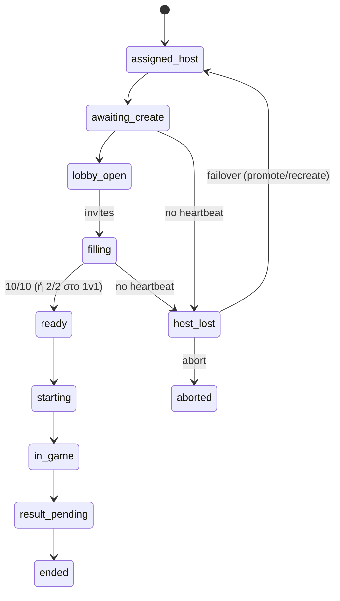
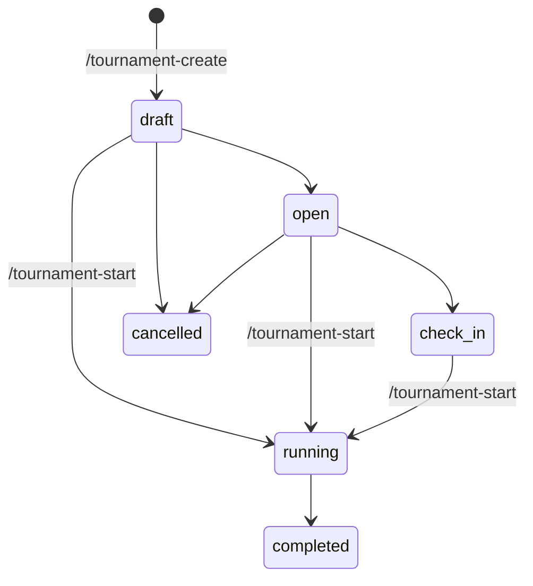

# Tournament flow — από τη δημιουργία μέχρι το τέλος

Απλό overview του πραγματικού flow, όπως είναι υλοποιημένο σήμερα στον κώδικα.
Κάθε βήμα δείχνει **πού** γίνεται (Discord bot / desktop client / web SPA) και
ποιο endpoint χτυπάει.

---

## 1. Το μεγάλο διάγραμμα

```mermaid
flowchart TD
    subgraph SETUP["0 · Setup (μία φορά ανά server)"]
        A1["Bot μπαίνει στο Discord server<br/>on_guild_join / on_ready sweep"] --> A2["Guild onboarded<br/>(tenant row + RLS scope)"]
    end

    subgraph ID["1 · Ταυτοποίηση παίκτη (μία φορά ανά παίκτη)"]
        B1["Discord: /register<br/>→ one-time code"] --> B2["Desktop client: paste code<br/>POST /auth/desktop-pair"]
        B2 --> B3["Desktop διαβάζει LCU Riot ID + region<br/>POST /accounts/verify-desktop"]
        B3 --> B4["Backend: Account-V1 by-riot-id<br/>→ canonical PUUID + rank snapshot"]
        B4 --> B5["Discord DM: account linked ✓"]
    end

    subgraph CREATE["2 · Δημιουργία tournament (admin)"]
        C1["Discord: /tournament-create<br/>mode = 1v1 ARAM ή 5v5 SR"] --> C2["POST /tournaments<br/>status = DRAFT"]
        C2 --> C3["Bot εμφανίζει το<br/>TOURNAMENT JOIN CODE"]
    end

    subgraph TEAM["3a · Δημιουργία team (μόνο για 5v5)"]
        D1["POST /teams<br/>→ TEAM JOIN CODE"] --> D2["Μέλη: POST /teams/join-by-code<br/>→ status PENDING"]
        D2 --> D3["Captain: approve join request<br/>→ status ACTIVE"]
    end

    subgraph ENROL["3b · Εγγραφή στο tournament"]
        E0["Desktop → Tournaments<br/>paste join code → Join<br/>GET /tournaments/by-code/{code}"]
        E0 --> E1["POST /tournaments/join-by-code"]
        E1 --> E2{"game_mode.team_size"}
        E2 -->|"5v5 (captain μόνο)<br/>captain σε >1 ομάδες:<br/>διαλέγει ποια μπαίνει"| E3["Registration της ομάδας<br/>status = PENDING"]
        E2 -->|"1v1 (solo)"| E4["auto: κρυφή ομάδα ενός παίκτη<br/>με το username του παίκτη<br/>(is_solo) + Registration PENDING"]
        E3 --> E5["Lock in<br/>POST /tournaments/{id}/check-in<br/>→ status CHECKED_IN"]
        E4 --> E5
    end

    subgraph START["4 · Έναρξη (admin)"]
        F1["Discord: /tournament-start"] --> F2["seeds = registrations με CHECKED_IN<br/>(σειρά εγγραφής = seeding)"]
        F2 --> F3["Bracket: Match rows<br/>tournament → RUNNING"]
        F3 --> F4["Byes → WALKOVER,<br/>auto-advance"]
    end

    subgraph MATCH["5 · Ένας αγώνας"]
        G1["Captains: POST /matches/{id}/ready"] --> G2["Admin: POST /orchestration/matches/{id}/lobby<br/>ορίζεται host player"]
        G2 --> G3["LCU lobby state machine στον host"]
        G3 --> G4["Worker watchdog:<br/>heartbeats + failover"]
        G3 --> G5["Desktop clients στέλνουν<br/>result reports (WebSocket)"]
        G5 --> G6["Corroboration: quorum + anomaly"]
        G6 --> G7["Admin: POST /results/matches/{id}/winner"]
        G7 --> G8["Match COMPLETED<br/>+ advance στο επόμενο match"]
    end

    subgraph END["6 · Τέλος"]
        H1["Επανάληψη μέχρι τον τελικό"] --> H2["Τελικός: ο νικητής δεν έχει next match<br/>→ advance = no-op"]
    end

    A2 --> C1
    B5 --> E0
    C3 --> E0
    D3 --> E0
    E5 --> F1
    F4 --> G1
    G8 --> H1
```

---

## 2. Το lobby state machine (ένα match)

---

## 3. Καταστάσεις tournament

---

## 4. Πού γίνεται τι

| Ενέργεια | Πού | Ποιος |
|---|---|---|
| `/register` (one-time code) | Discord | παίκτης |
| Pair + link Riot account | Desktop client | παίκτης |
| `/tournament-create` | Discord | admin |
| Δημιουργία team + team join code | Desktop / web SPA | οποιοσδήποτε |
| Redeem **tournament** join code | **μόνο** Desktop client | παίκτης / captain |
| Διάλεξε ποια ομάδα μπαίνει (5v5) | Desktop client | captain πολλών ομάδων |
| Lock in | Desktop client (και web SPA) | ο ίδιος ο παίκτης / captain |
| `/tournament-start` | Discord | admin |
| Ready-up | Desktop client | captain |
| Δημιουργία lobby | web SPA / API | admin |
| Παίξιμο του match (LCU) | Desktop client | host + παίκτες |
| Ορισμός νικητή | web SPA / API | admin |

---

## 5. Πώς δουλεύει το 1v1 (χωρίς ομάδα)

Ο παίκτης δεν φτιάχνει ποτέ ομάδα και δεν βλέπει τη λέξη "team":

1. Παίρνει τον κωδικό του tournament και τον βάζει στο desktop → **Join**.
2. Ο backend φτιάχνει σιωπηλά μια **ομάδα ενός παίκτη με το username του**
   (`teams.is_solo`) και την εγγράφει `PENDING`. Γι' αυτό το bracket δείχνει το
   όνομά του και όχι κενό slot.
3. Το detail panel δείχνει `2 / 2 players · ποιος έκανε lock in`, με τη δική του
   γραμμή σημειωμένη (`is_you`).
4. Πατάει **Lock in** → `CHECKED_IN`.
5. Με 2 locked-in παίκτες, το `/tournament-start` φτιάχνει το bracket κανονικά.

Η solo ομάδα είναι αόρατη παντού αλλού: δεν εμφανίζεται στη λίστα ομάδων, δεν
έχει join code, και δεν μετράει ως "captained team" σε ένα μετέπειτα 5v5.

---

## 5b. Πώς δουλεύει το 5v5

1. Ο captain φτιάχνει ομάδα (`POST /teams`) και μοιράζει το **team join code**·
   τα μέλη κάνουν join και ο captain τα εγκρίνει.
2. Παίρνει τον κωδικό του tournament και τον βάζει στο desktop → **Join**.
   Ο client πρώτα κάνει `GET /tournaments/by-code/{code}` για να δει το mode
   **πριν** εγγραφεί.
3. Αν είναι captain σε **πολλές** ομάδες, εμφανίζεται λίστα και διαλέγει ποια
   μπαίνει. Με μία ομάδα μπαίνει κατευθείαν· με καμία βλέπει "φτιάξε ομάδα πρώτα".
4. **Lock in** — μόνο ο captain. Τα υπόλοιπα μέλη βλέπουν την κατάσταση
   ("waiting for your captain"), όχι κουμπί.
5. Με ≥2 locked-in ομάδες, ο admin κάνει `/tournament-start`.

Το lock-in ψάχνει τη σωστή ομάδα **μέσα σε αυτό το tournament**, οπότε ένας
captain πολλών ομάδων δεν χρειάζεται να ξαναπεί ποια.

---

## 6. Κενά που υπάρχουν ακόμη

1. **Το tournament δεν κλείνει ποτέ μόνο του.** Κανένα σημείο του κώδικα δεν
   γράφει `TournamentStatus.COMPLETED` — το βήμα 6 του διαγράμματος είναι
   λογικό, όχι υλοποιημένο.
2. **Scheduled start δεν υπάρχει.** Το `start_at` μόνο *κλείνει* τις εγγραφές
   (`tournaments/service.py`)· ο worker δεν έχει κανένα ενεργό cron job
   (`worker/src/app/main.py`, όλα σχολιασμένα), άρα το start είναι πάντα
   χειροκίνητο από admin.
3. **Corroboration είναι stub.** `score_corroboration` στον worker πετάει
   `NotImplementedError`· η απόφαση περνάει σήμερα από τον admin.
